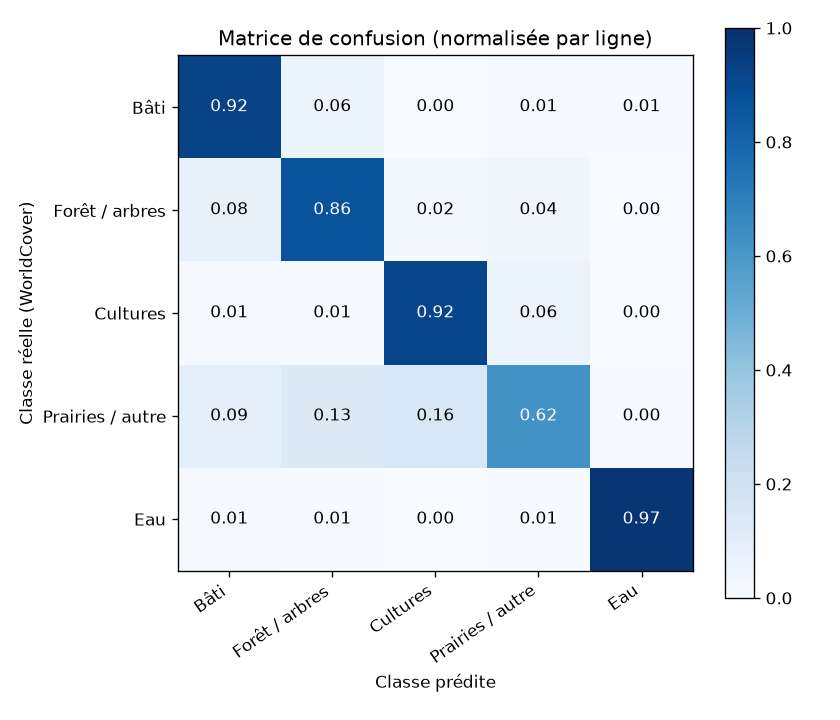

# Artificialisation du plateau de Saclay (2017 → 2025) par segmentation UNet

Projet réalisé dans le cadre du cours **« IA et changement climatique »** (ESIEE Paris, E4, automne 2026).

**Objectif :** mesurer l'artificialisation des sols autour du plateau de Saclay entre 2017 et 2025, à partir d'images satellites Sentinel-2 et d'un réseau de segmentation UNet entraîné sur les labels ESA WorldCover.

## Démarche

1. **Données** : images Sentinel-2 L2A (bleu, vert, rouge, proche infrarouge, 10 m) d'été 2017, 2021 et 2025, sélectionnées automatiquement pour minimiser les nuages sur la zone ; labels ESA WorldCover 2021 regroupés en 5 classes.
2. **Entraînement** : UNet entraîné sur l'image 2021 avec les labels WorldCover 2021.
3. **Prédiction** : application du modèle aux images 2017 et 2025.
4. **Indicateur** : carte des changements et taux d'artificialisation entre les deux dates.

| Classe | Classes WorldCover d'origine |
|---|---|
| Bâti | Built-up |
| Forêt / arbres | Tree cover, mangroves |
| Cultures | Cropland |
| Prairies / autre | Shrubland, grassland, bare, snow, wetland, moss |
| Eau | Permanent water |

## Choix méthodologiques

- **Harmonisation radiométrique** : suppression du décalage de +1000 introduit par l'ESA en janvier 2022 (processing baseline 04.00), pour rendre 2025 comparable à 2017 et 2021.
- **Même saison** pour les trois années (mi-juin à fin juillet), pour éviter de confondre champs moissonnés et surfaces artificialisées.
- **Normalisation globale** par percentiles 2–98 % calculés une fois sur l'image 2021 et réappliqués aux autres années.
- **Découpage train / validation / test par blocs géographiques de 5 km**, pour éviter la fuite d'information entre patches voisins.
- **Pondération des classes** et pixels sans donnée ignorés.
- **Évaluation** par IoU par classe, F1 et matrice de confusion (l'accuracy seule est trompeuse avec des classes déséquilibrées).

## Résultats actuels (entraînement court, 10 époques)

Évaluation sur le jeu de test (blocs géographiques jamais vus pendant l'entraînement) :

| Classe | IoU | F1 | Précision | Rappel |
|---|---|---|---|---|
| Bâti | 0,81 | 0,89 | 0,86 | 0,92 |
| Forêt / arbres | 0,80 | 0,89 | 0,92 | 0,86 |
| Cultures | 0,82 | 0,90 | 0,88 | 0,92 |
| Prairies / autre | 0,48 | 0,65 | 0,68 | 0,62 |
| Eau | 0,67 | 0,80 | 0,68 | 0,97 |

**mIoU : 0,72** — accuracy globale : 0,87. Entraînement de 12,6 min sur Apple M4 Max.



## Structure

```
01_donnees_saclay.ipynb       Téléchargement et préparation (Microsoft Planetary Computer)
02_entrainement_unet.ipynb    Entraînement et évaluation du UNet
tutoriel/                     Tutoriel UNet du cours, adapté à Apple Silicon
data_saclay/                  Métadonnées et aperçus (les rasters ne sont pas versionnés)
resultats/                    Figures, métriques et configuration d'entraînement
```

## Reproduire

```bash
python3.11 -m venv venv
source venv/bin/activate
pip install -r requirements.txt
```

Puis exécuter les notebooks dans l'ordre. Les données sont téléchargées automatiquement depuis le Microsoft Planetary Computer (aucun compte nécessaire). Testé sur Mac Apple Silicon (TensorFlow 2.18 + tensorflow-metal 1.2).

## Limites

- WorldCover est lui-même une prédiction (précision globale annoncée d'environ 75 %) : le modèle en apprend aussi les erreurs.
- La résolution de 10 m produit des pixels mixtes en zone pavillonnaire.
- Le modèle est entraîné sur 2021 puis appliqué à d'autres années : les différences d'acquisition restantes peuvent créer de faux changements.

## Sources

- Sentinel-2 L2A : Copernicus / ESA, via Microsoft Planetary Computer
- ESA WorldCover 2021 v200 : Zanaga et al., 2022
