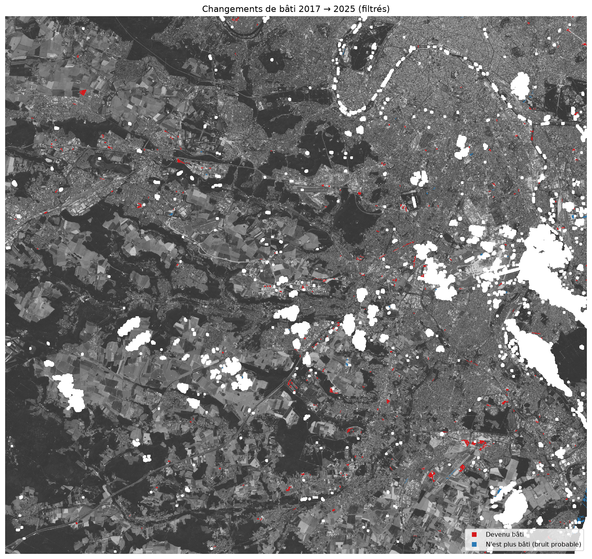
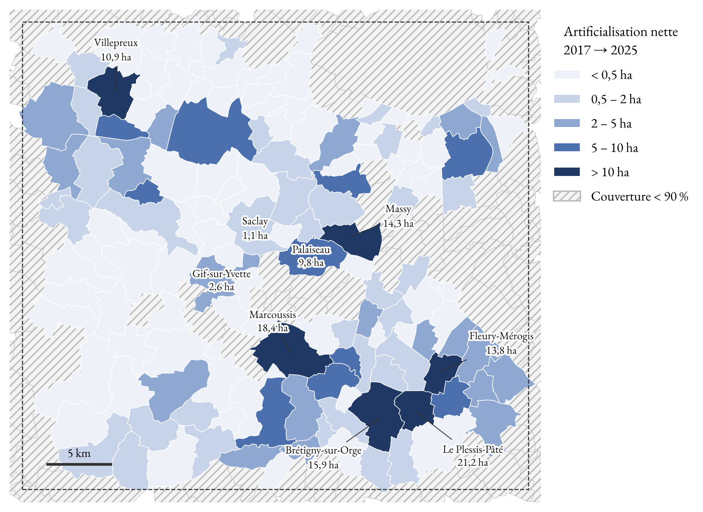

# Artificialisation du plateau de Saclay (2017 → 2025) par segmentation UNet

Projet réalisé dans le cadre du cours **« IA et changement climatique »** (ESIEE Paris, E4, automne 2026).

**Objectif :** mesurer l'artificialisation des sols autour du plateau de Saclay entre 2017 et 2025, à partir d'images satellites Sentinel-2 et d'un réseau de segmentation UNet entraîné sur les labels ESA WorldCover.

## Démarche

1. **Données** : images Sentinel-2 L2A (bleu, vert, rouge, proche infrarouge, 10 m) du 18/07/2017, 19/07/2021 et 01/07/2025, choisies au plus près du 19 juillet avec moins de 5 % de nuages sur la zone (nuages masqués) ; labels ESA WorldCover 2021 regroupés en 5 classes.
2. **Entraînement** : UNet entraîné sur l'image 2021 avec les labels WorldCover 2021.
3. **Prédiction** : application du modèle aux images 2017 et 2025.
4. **Indicateur** : flux de pixels devenus bâtis, filtrés (confiance, surface minimale), avec analyse de sensibilité et validation par photo-interprétation.
5. **Déclinaison territoriale** : ventilation par commune et intercommunalité, et comparaison avec la consommation d'espaces NAF mesurée par le Cerema (fichiers fonciers).

| Classe | Classes WorldCover d'origine |
|---|---|
| Bâti | Built-up |
| Forêt / arbres | Tree cover, mangroves |
| Cultures | Cropland |
| Prairies / autre | Shrubland, grassland, bare, snow, wetland, moss |
| Eau | Permanent water |

## Choix méthodologiques

- **Harmonisation radiométrique** : suppression du décalage de +1000 introduit par l'ESA en janvier 2022 (processing baseline 04.00), pour rendre 2025 comparable à 2017 et 2021.
- **Même stade de végétation** : dates choisies au plus près de la date d'entraînement (une image de juin 2017, aux céréales encore vertes, faussait toute la classification).
- **Augmentation radiométrique** à l'entraînement (gain, décalage, gamma par bande), plus efficace qu'un appariement d'histogrammes des images.
- **Normalisation globale** par percentiles 2–98 % calculés une fois sur l'image 2021 et réappliqués aux autres années.
- **Découpage train / validation / test par blocs géographiques de 5 km**, pour éviter la fuite d'information entre patches voisins.
- **Pondération des classes** et pixels sans donnée ignorés.
- **Évaluation** par IoU par classe, F1 et matrice de confusion (l'accuracy seule est trompeuse avec des classes déséquilibrées).

## Résultats

**Modèle** (jeu de test, blocs géographiques jamais vus ; 55 époques, 1 h 48 sur Apple M4 Max) :

| Classe | IoU | F1 | Précision | Rappel |
|---|---|---|---|---|
| Bâti | 0,80 | 0,89 | 0,86 | 0,93 |
| Forêt / arbres | 0,81 | 0,89 | 0,91 | 0,88 |
| Cultures | 0,83 | 0,91 | 0,93 | 0,89 |
| Prairies / autre | 0,49 | 0,66 | 0,67 | 0,65 |
| Eau | 0,69 | 0,82 | 0,72 | 0,95 |

**mIoU : 0,73** — accuracy globale : 0,87.

**Artificialisation 2017 → 2025** (flux de pixels non bâti → bâti, confiance ≥ 0,7 aux deux dates, taches ≥ 0,5 ha) :

| Période | Gains | Pertes (bruit) | Net | Net par an |
|---|---|---|---|---|
| 2017 → 2021 | 190 ha | 29 ha | 161 ha | 40 ha |
| 2021 → 2025 | 159 ha | 82 ha | 76 ha | 19 ha |
| **2017 → 2025** | **335 ha** | **60 ha** | **275 ha** | **34 ha** |

- Précision des détections, estimée par photo-interprétation de 30 taches : **88 %** (IC 95 % : 75–100 %).
- Origine des surfaces artificialisées : forêt / arbres 47 %, prairies 29 %, cultures 23 %.
- Le total dépend fortement des seuils de filtrage (≈ 180 à 400 ha pour des réglages raisonnables) : c'est un ordre de grandeur.



**Par commune et comparaison avec le Cerema** (147 communes analysées sur au moins 90 % de leur surface) :

- l'artificialisation est concentrée : 10 communes font 54 % du total, surtout au sud-est (Le Plessis-Pâté, Brétigny-sur-Orge, Marcoussis, Massy) ;
- 243 ha mesurés contre 901 ha de consommation d'espaces NAF selon le Cerema (2017–2024), soit ≈ 27 % ; corrélation de rang de Spearman de 0,49 ;
- bonne localisation (25 des 26 communes à plus de 10 ha selon le Cerema ont au moins une détection), forte sous-estimation des surfaces : le Cerema compte la parcelle entière et date le changement à l'achèvement des constructions, alors que le modèle détecte les surfaces d'apparence bâtie dès le chantier.



## Structure

```
01_donnees_saclay.ipynb       Téléchargement et préparation (Microsoft Planetary Computer)
02_entrainement_unet.ipynb    Entraînement et évaluation du UNet
03_prediction.ipynb           Cartes d'occupation du sol 2017, 2021, 2025
04_indicateurs.ipynb          Flux d'artificialisation, sensibilité, validation visuelle, analyse par commune
tutoriel/                     Tutoriel UNet du cours, adapté à Apple Silicon
data_saclay/                  Métadonnées, aperçus, contours des communes (IGN Admin Express 2018)
                              et extrait des données Cerema (les rasters ne sont pas versionnés)
resultats/                    Figures, métriques et configuration d'entraînement
```

## Reproduire

```bash
python3.11 -m venv venv
source venv/bin/activate
pip install -r requirements.txt
```

Puis exécuter les notebooks dans l'ordre. Les données sont téléchargées automatiquement depuis le Microsoft Planetary Computer (aucun compte nécessaire). Testé sur Mac Apple Silicon (TensorFlow 2.18 + tensorflow-metal 1.2).

## Limites

- WorldCover est lui-même une prédiction (précision globale annoncée d'environ 75 %) : le modèle en apprend aussi les erreurs.
- La résolution de 10 m produit des pixels mixtes en zone pavillonnaire.
- Le modèle est entraîné sur 2021 puis appliqué à d'autres années : les différences d'acquisition restantes peuvent créer de faux changements.

## Sources

- Sentinel-2 L2A : Copernicus / ESA, via Microsoft Planetary Computer
- ESA WorldCover 2021 v200 : Zanaga et al., 2022

## Sources des données

- Images Sentinel-2 L2A : programme Copernicus (ESA), via le Microsoft Planetary Computer.
- Labels : ESA WorldCover 10 m 2021 v200 (Zanaga et al., 2022).
- Contours communaux : IGN Admin Express COG, édition 2018, version simplifiée de [france-geojson](https://github.com/gregoiredavid/france-geojson).
- Consommation d'espaces NAF : Cerema, [« Consommation d'espaces naturels, agricoles et forestiers du 1er janvier 2011 au 1er janvier 2025 »](https://www.data.gouv.fr/fr/datasets/6a01b9280dd2d45907e5fc61/) (extrait limité aux communes de la zone).
